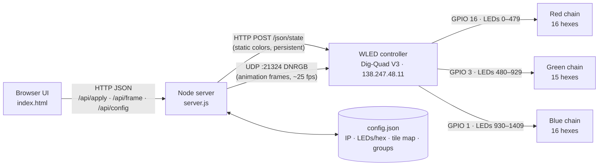

# Hex Panel Control: System Architecture

## 1. Overview

The hex panel is a wall of 47 hexagonal light tiles in three color groups (16 red, 15 green, 16 blue). Each hex holds 30 addressable LEDs, 1410 LEDs in all. A WLED controller (Dig-Quad V3, ESP32) drives them. This system lets a user pick hexes on a screen map, give them colors or animated patterns, and see the result on the real panel straight away.



## 2. Components

| Layer | File | Responsibility |
|---|---|---|
| Presentation | `index.html` | Hex map, selection (All / Select / Groups), color and pattern controls, pattern engine, tile-mapping wizard |
| Service | `server.js` | Serves the UI, stores settings, turns tile colors into LED data, talks to WLED |
| Persistence | `config.json` | WLED IP, LEDs per hex, LED offset, tile → chain map, saved groups |
| Device | WLED 0.14 on ESP32 | Drives the three LED outputs; holds segments 0–2 |
| Hardware | 3 LED chains | One data pin per color group, 30 LEDs per hex |

The server exists because a web page can't send UDP, and browsers block a page from calling a device on the local network. Node has no such limits and needs no extra packages.

## 3. Data model

**Tile:** one hex. Each tile has these fields:
- `n`: the tile number, 1–47. Red is numbered first, then green, then blue, right to left within each group.
- `tag`: R1…R16, G1…G15, B1…B16.
- `q, r`: axial hex coordinates (pointy-top layout).
- `col, row`: col counts from the right edge in half-tile steps (1–29). Row runs top to bottom (1–7).

**Chain map:** `map[n-1] = chain position`. Tile *n* uses LEDs `offset + pos × 30` up to `+ 29`. The mapping wizard fills this in by lighting each chain position in turn while the user clicks the hex that lit.

**Frame:** an array of 47 `"RRGGBB"` strings, one per tile. This is the only thing the UI sends. The server expands it to 1410 LEDs.

**Layer:** one running pattern. It holds its tiles, pattern, color, speed and direction, plus a path order (`pos`, `L`). Layers are composited on top of the static colors, and a later layer wins where two overlap. Each tile belongs to at most one layer.

**Off mask:** a set of tiles forced dark. These tiles stay dark under any pattern until they are turned back on.

**LED geometry:** each hex is modeled as a ring of 30 LEDs just inside its edge. Spots 0–29 run clockwise from the top corner. A per-hex layout `{j0, dir}` says which spot LED 0 sits on and which way the strip runs. It is stored in `config.json` as `ledLayout.all` plus per-hex overrides in `ledLayout.tiles`. From this, every LED gets a board position (x, y), so effects can tell up from down. The **Check LED layout** tool lights LED 0 white with a green trail on one hex, and the user clicks the matching dot and picks a direction.

**LED frame:** while an LED effect (rain, fire) runs, the UI sends 1410 colors instead of 47. They are ordered tile by tile, then LED 0–29 inside each tile, and the server maps them through the chain map exactly like tile frames.

## 4. Data flows

**Static color** (Solid, Off, Original colors):
1. The UI sends `POST /api/apply {colors[47], bri}`.
2. The server expands the colors to LEDs and reads WLED's segments.
3. It sends `POST http://WLED/json/state`, writing each segment's slice with `seg[k].i` run-length ranges.
4. WLED freezes each segment on these colors, so they stay after the app closes.

**Animation** (Chase, Wave, Fill, Breathe, Blink, Rainbow):
1. The UI computes a frame every 40 ms and sends `POST /api/frame`.
2. The server sends UDP DNRGB packets (protocol 4, 2 s timeout, at most 489 LEDs per packet, so 3 packets per frame) to port 21324.
3. When the patterns stop, the UI sends a static apply so the panel settles on the real colors.

**Direction:**
- *Right to left* orders a layer's tiles by `col`.
- *Clockwise* and *counter-clockwise* sort tiles by angle around the selection's center, starting at 3 o'clock. Loops wrap around without a break.

## 5. Design decisions

| Decision | Reason |
|---|---|
| JSON API for static colors, UDP for animation | JSON keeps state after the app closes. UDP is fast enough for 25 fps and lapses back to static colors on its own. |
| Write every WLED segment | The device has overlapping segments 0–2. Writing only segment 0 left green and blue showing, which was a real bug that has been fixed. |
| Tile-level frames, LED expansion on the server | The UI never needs to know LED counts or wiring. Rewiring changes only `config.json`. |
| Chain map learned by the wizard | The order inside each group isn't visible from the front. It was mapped once and saved (B7–B10 turned out to be wired in a different order). |
| No dependencies | It runs anywhere with Node 18+, with no `npm install`. |

## 6. Known limits

- **Patterns need the browser open.** The pattern engine runs in the page, so closing the tab stops the animation. The panel then holds the last static colors after 2 s.
- **One controlling client.** Two open browsers would each send their own frames and fight over the panel.
- **No authentication.** Anyone who can reach port 8080, or reach WLED directly, can change the panel. The WLED address 138.247.48.11 is on the campus network, not a private home range, so check with campus IT how widely it can be reached.
- **The layout is hard-coded.** The 47 positions are in `index.html`. Moving tiles on the board means editing `RAW`.

## 7. Proposed next version

1. **Move the pattern engine into `server.js`.** The UI would send a layer definition, not frames, and the server would run the 25 fps loop. Animations would keep going with no browser open, and any number of viewers could watch.
2. **Use a WebSocket for live state.** The server would push the current frame to every open UI, so phones and laptops stay in sync.
3. **Run it on a Raspberry Pi next to the panel**, using a systemd service so it starts at boot. Point a QR code at `http://<pi>:8080` for visitors.
4. **Save scenes.** Store named sets of static colors plus layers in `config.json`, and allow a schedule such as an idle animation after hours.
5. **Lock it down.** Add a simple PIN for control, keep WLED on an isolated VLAN, and turn on WLED's settings PIN and OTA lock.
6. **Move the layout into `config.json`** so a rearranged board needs no code change.

## 8. Running it

```bash
node server.js
```

Then open http://localhost:8080. The WLED IP, LEDs per hex and the tile map are already saved in `config.json`.

| Endpoint | Method | Body | Purpose |
|---|---|---|---|
| `/api/config` | GET / POST | settings object | Read or save settings |
| `/api/apply` | POST | `{colors[47], bri, raw?}` | Static colors through the WLED JSON API |
| `/api/frame` | POST | `{colors[47], bri}` | One animation frame through UDP |
| `/api/ping` | GET | | WLED name, version and LED count |
